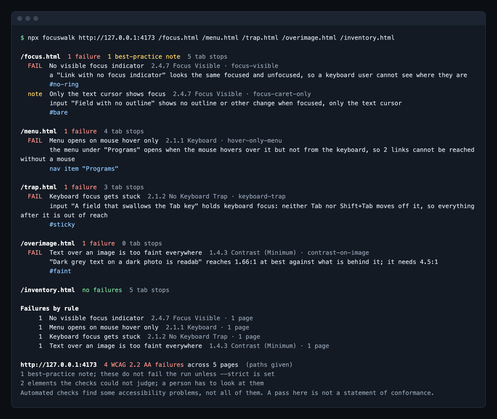
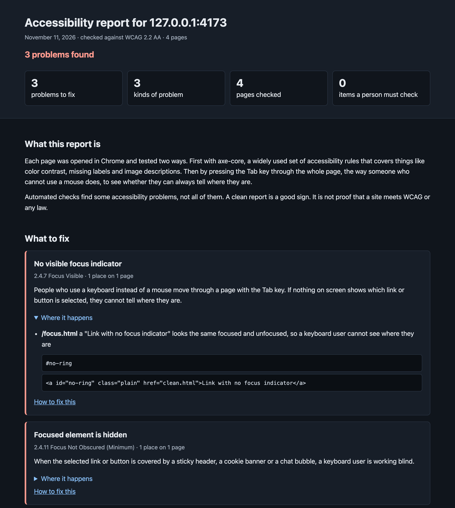
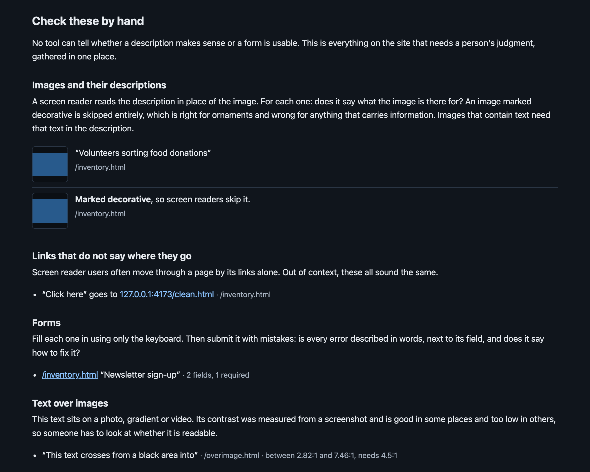

# accessready

> WCAG 2.2 AA audit for a whole site. Runs axe-core, then uses every page the way a keyboard user does, in real Chrome, to catch what rule engines miss.

[](https://www.npmjs.com/package/accessready)
[](https://github.com/MikeSewell/accessready/actions/workflows/ci.yml)
[](https://github.com/MikeSewell/accessready/blob/main/LICENSE)

```sh
npx accessready https://example.org
```



It reads the sitemap, audits every page, and exits 1 if anything fails, so it can gate a deploy.

## Why

Most accessibility checkers are built on [axe-core](https://github.com/dequelabs/axe-core). It is very good at what a rules engine can decide from the page's code: contrast, labels, alt text, ARIA. accessready runs it on every page.

But many of the problems that lock people out can't be decided from code. You have to use the page. So after axe-core, accessready does:

| It does this | To catch this | WCAG |
|---|---|---|
| Presses Tab to every element and screenshots it focused and unfocused | A link or button that shows nothing when it has focus | 2.4.7 |
| Checks whether anything of the focused element can be seen | Focus hidden under a sticky header, cookie banner or chat bubble | 2.4.11 |
| Keeps pressing Tab, then Shift+Tab | A field that keyboard focus can't leave | 2.1.2 |
| Looks for controls that can't take focus | A `div` with a click handler that only a mouse can use | 2.1.1 |
| Hovers each menu, then tries the same from the keyboard | A menu that only opens on mouse hover | 2.1.1 |
| Presses Enter and Space on buttons that open something | A button that answers a click but not the keyboard | 2.1.1 |
| Widens line, letter and word spacing | Text that gets cut off when a reader adjusts spacing | 1.4.12 |
| Hides the text and measures the pixels behind it | Text too faint to read over a photo or gradient | 1.4.3 |
| Resizes to 320px wide | A page that scrolls sideways when zoomed | 1.4.10 |
| Finds video with no controls and no pause button | Video that plays by itself and can't be stopped | 2.2.2 |
| Compares the main navigation across every page | A menu in a different order on one page | 3.2.3 |
| Compares header and footer links, search and help across pages | A contact link renamed on one page, or help that moves | 3.2.4, 3.2.6 |
| Looks for search, a site map page or related links besides the menu | A site you can only get around by its menu | 2.4.5 |
| Downloads every linked PDF and reads it | A scanned or untagged PDF, or one with no title or language | 1.1.1, 1.3.1, 2.4.2, 3.1.1 |

As of axe-core 4.14, it has no rule for focus visibility, hidden focus, keyboard traps, hover-only menus, reflow or navigation order, and it hands text over images back as "needs review".

### What it covers

<!-- coverage:start -->
| Of the 86 WCAG 2.2 A and AA criteria | |
|---|---|
| 38 | have at least one automated check that can fail a page |
| 3 | are judged only by the optional AI review, for a person to confirm |
| 7 | are not judged, but the HTML report lists exactly what a person has to look at |
| 10 | need a person, with no help from the tool |
<!-- coverage:end -->

Every criterion, what is tested and what is left to a person: [docs/COVERAGE.md](https://github.com/MikeSewell/accessready/blob/main/docs/COVERAGE.md). The table is generated from the code and checked on every commit.

For the part no tool can judge, the HTML report gives you a worklist instead of a warning: every image with its description beside it, every video, every form, every "click here" link, and each page's heading outline.

## Why not

- **A pass is not conformance.** Automated checks find some accessibility problems, not all of them. Deque, who make axe-core, put their own coverage at [57% of issues by volume](https://www.deque.com/blog/automated-testing-study-identifies-57-percent-of-digital-accessibility-issues). When the UK government ran ten tools against a page of planted barriers, [all of them together found 71%](https://accessibility.blog.gov.uk/2017/02/24/what-we-found-when-we-tested-tools-on-the-worlds-least-accessible-webpage/). You still need a person with a keyboard and a screen reader.
- **It is not a legal opinion.** It won't tell you a site is "ADA compliant", and neither will any other tool.
- **It only drives Chrome.** No Firefox or Safari.
- **It doesn't use your site like a visitor with a goal.** It opens menus and presses buttons that say they expand something, but it never submits a form, logs in or steps through a checkout.
- If you only need rule checks on a handful of URLs, [`@axe-core/cli`](https://github.com/dequelabs/axe-core-npm/tree/develop/packages/cli) or [`pa11y-ci`](https://github.com/pa11y/pa11y-ci) are smaller.

## Install

Needs Node 22 or newer, and Google Chrome. If Chrome isn't installed, accessready uses Playwright's Chromium instead:

```sh
npx playwright install chromium
```

Run it without installing:

```sh
npx accessready https://example.org
```

Or add it to a project:

```sh
npm install --save-dev accessready
```

## Usage

```
accessready <url> [path ...] [options]
```

```sh
accessready https://example.org              # every page in /sitemap.xml
accessready https://example.org / /donate    # only these paths
accessready https://example.org/donate       # only this page
accessready http://localhost:3000            # a local build, before it ships
```

When you point it at localhost, URLs in the sitemap are rewritten onto localhost, so a production sitemap works against a local build.

| Option | Default | What it does |
|---|---|---|
| `--html <file>` | | Write a report a non-developer can read |
| `--json <file>` | | Write the full results as JSON. `-` prints to stdout |
| `--sarif <file>` | | Write SARIF 2.1.0, for GitHub code scanning |
| `--config <file>` | `accessready.config.json` | Options and ignored findings from a file |
| `--baseline <file>` | | Fail only on findings that are not in this saved baseline |
| `--update-baseline` | | Save the current findings to the `--baseline` file |
| `--sitemap <url>` | `<url>/sitemap.xml` | Sitemap to read. Sitemap indexes are followed one level |
| `--max <n>` | 40 | Most pages to audit from a sitemap |
| `--concurrency <n>` | 2 | Pages audited at once |
| `--storage-state <file>` | | Playwright storage state, to audit logged-in pages |
| `--viewport <WxH>` | 1440x900 | Browser window size. Try `390x844` for a phone |
| `--max-tab-stops <n>` | 150 | Most Tab presses per page |
| `--timeout <ms>` | 45000 | Page load timeout |
| `--browser <name>` | auto | `auto`, `chrome` or `chromium` |
| `--proxy <url>` | | Send browser traffic through a proxy |
| `--no-dismiss` | | Leave cookie banners alone instead of clicking Reject |
| `--strict` | | Also fail on best-practice notes |
| `--no-color` | | Plain output. `NO_COLOR` works too |

### Exit codes

| Code | Meaning |
|---|---|
| 0 | No failures. With `--baseline`: no new failures |
| 1 | Failures found. With `--baseline`: new failures found |
| 2 | The audit could not finish: bad arguments or config, no browser, or a page would not load |

### Config file

Put `accessready.config.json` in the folder you run from, or name one with `--config`. It sets defaults for any option, using the option names in camelCase (`storageState`, `maxTabStops`, `dismiss: false`). Options on the command line win. File paths in it are read from the config file's folder.

```json
{
  "url": "http://localhost:3000",
  "paths": ["/", "/donate", "/contact"],
  "viewports": ["desktop", "phone"],
  "level": "AA",
  "ignore": [
    { "rule": "color-contrast", "page": "/blog/*", "selector": ".share-widget", "reason": "Vendor widget; fix requested in ticket 4411" }
  ]
}
```

With `url` set, `npx accessready` on its own runs the audit, and `npx accessready /donate` audits one path of it.

Each `ignore` names a `rule` (the id shown after each finding) and may narrow it to a `page` (`*` matches anything) and a `selector`. A `reason` is required: an ignore without one stops the run with exit code 2. Ignored findings leave the totals and the reports; the console says how many, and the JSON lists each under `ignored` with its reason.

### Baseline

To start using accessready on a site that already has problems, save them once and fail only on new ones:

```sh
accessready https://staging.example.org --baseline accessready-baseline.json --update-baseline
accessready https://staging.example.org --baseline accessready-baseline.json
```

The second run reports how many known findings it skipped, lists the new ones and the ones fixed since the baseline, and exits 1 only for new failures. Findings are matched by rule, page path, element and message with numbers taken out, so a contrast ratio that moves from 4.31:1 to 4.29:1, or a different host, does not count as new. Commit the baseline and refresh it with `--update-baseline` as problems get fixed.

### Failures and notes

A **failure** is a WCAG 2.2 A or AA problem the tool is sure of. A **note** is either recognized good practice that WCAG doesn't require (heading levels that skip), or something that needs a person to confirm (an element with a pointer cursor that Tab never reaches). Notes are printed but only fail the run with `--strict`.

axe-core also returns items it could not judge. Where that is text over an image, accessready measures it: if it fails everywhere it becomes a failure, if it passes everywhere it is dropped, and if it is mixed it goes on the report's worklist with the measured range.

## The HTML report

```sh
accessready https://example.org --html report.html
```

One file, written for the person who owns the site as much as the developer who fixes it. Problems are grouped by kind, with a plain explanation of who each one affects. Below them is the worklist of what to check by hand.





The report passes its own audit. That is tested on every commit.

## In CI

### The GitHub Action

```yaml
name: Accessibility
on: [pull_request]

permissions:
  contents: read
  pull-requests: write      # to comment the summary
  # security-events: write  # with upload-sarif: true

jobs:
  accessready:
    runs-on: ubuntu-latest
    steps:
      - uses: actions/checkout@v7
      - uses: MikeSewell/accessready@main   # pin to a release tag or commit
        with:
          url: https://staging.example.org
          paths: / /donate /contact
          # args: --viewports desktop --max 20
          # config: accessready.config.json
          # baseline: accessready-baseline.json
          # upload-sarif: true
```

It installs the accessready of the tag or commit you point at, audits, uploads the HTML report as an artifact, writes the summary to the run page and, on pull requests, posts it as a comment that later runs edit instead of adding new ones. With `upload-sarif: true` the findings also appear in the repository's code scanning alerts. The step fails exactly when the command line would (exit code 1 or 2), and its `exit-code`, `html`, `json` and `sarif` outputs are there for later steps.

To audit the pull request's own build, start the server in an earlier step and use `url: http://localhost:<port>`.

### By hand

GitHub Actions, auditing a preview or staging URL:

```yaml
name: Accessibility
on: [pull_request]

jobs:
  accessready:
    runs-on: ubuntu-latest
    steps:
      - uses: actions/setup-node@v7
        with:
          node-version: 26
      - run: npx accessready https://staging.example.org --html accessready.html
      - uses: actions/upload-artifact@v7
        if: always()
        with:
          name: accessready-report
          path: accessready.html
```

GitHub's Ubuntu runners come with Chrome. On other CI systems, add `npx playwright install --with-deps chromium` before the audit.

To audit the build itself, start your server in the job and point accessready at `http://localhost:<port>`.

## Logged-in pages

Save a signed-in session once with Playwright, then hand it to accessready:

```sh
npx playwright codegen --save-storage=auth.json https://app.example.org/login
accessready https://app.example.org /dashboard /settings --storage-state auth.json
```

`auth.json` holds session cookies. Keep it out of version control.

The same trick gets a timed popup out of the way: dismiss it during `codegen` and, if the site remembers that in a cookie or local storage, the saved state carries it over. If a popup does open partway through an audit and covers the page, accessready says so and stops walking that page rather than reporting everything behind the popup as hidden.

## As a library

```js
import { audit, exitCode, renderHtml } from 'accessready';

const result = await audit('https://example.org', { max: 10 });
console.log(result.totals); // { pages, failures, advice, needsReview, errors }
process.exitCode = exitCode(result);
```

## What it does to your pages

accessready only does what a visitor could do. It clicks Reject on a cookie banner, presses Tab, hovers menus, and presses Enter on buttons marked `aria-expanded="false"`, closing each one again. It never presses Enter on a link. If a button navigates away anyway, it stops operating that page and says so.

To see how forms handle mistakes, it opens a separate copy of the page that cannot reach your server. While the copy loads, only GET and HEAD requests go out and service workers are off. Once the form test starts, every request, navigation and WebSocket message is stopped inside the browser and only recorded. In that copy it leaves required fields empty, types obvious nonsense such as `not-an-email` into typed fields, presses the submit button and reads what the page shows. It never types anything that looks like real data, tries at most three forms per page, and throws the copy away afterwards. If a form tries to send anyway, the report says so.

## How the focus check works

Reading CSS can't tell you whether a focus indicator is visible. A ring can be drawn by a wrapper with `:focus-within`, or by a pseudo-element. And a rule like `:focus { color: #333 }` on dark grey text changes a style and draws nothing you can see.

So accessready looks at pixels. At each Tab stop it screenshots the element and a small margin around it, blurs the element, screenshots again, and counts the pixels that differ. If nothing changed, a sighted keyboard user has no way to see where they are. Two details keep it honest:

- A failure is confirmed with a second look 300ms later, after transitions have finished, so a skip link that slides in is measured once it has arrived.
- Custom checkboxes and radios hide the real input, so the label or wrapper is the area compared.
- A date field takes several Tab presses to cross. The walk keeps pressing instead of mistaking it for a trap.

The demo pages under `test/fixtures/site` each plant one problem. Try it:

```sh
git clone https://github.com/MikeSewell/accessready.git && cd accessready && npm install
node test/serve.mjs &
node bin/accessready.mjs http://127.0.0.1:4173 /focus.html /menu.html /trap.html /overimage.html
```

## What the law says

accessready checks against WCAG 2.2 AA, which includes everything in 2.1 AA.

In the US, WCAG 2.1 AA is the technical standard for state and local government websites under the Department of Justice's [ADA Title II rule](https://www.ada.gov/resources/2024-03-08-web-rule/). For businesses and nonprofits there is no regulation naming a WCAG version; the Department's [web guidance](https://www.ada.gov/resources/web-guidance/) says it "does not have a regulation setting out detailed standards" and names WCAG among the existing standards that "provide helpful guidance".

This is background, not legal advice.

## Contributing

Bug reports and pull requests are welcome, especially false positives: a page where accessready reports something a person wouldn't. See [CONTRIBUTING.md](https://github.com/MikeSewell/accessready/blob/main/CONTRIBUTING.md).

## Who builds this

accessready is built by [Michael Sewell](https://msewell.com). It started as the accessibility check he runs before every deploy of the apps he builds for nonprofits at [Automate Impact](https://automateimpact.org).

## License

[MIT](https://github.com/MikeSewell/accessready/blob/main/LICENSE). axe-core is used unmodified under the [Mozilla Public License 2.0](https://github.com/dequelabs/axe-core/blob/develop/LICENSE).
